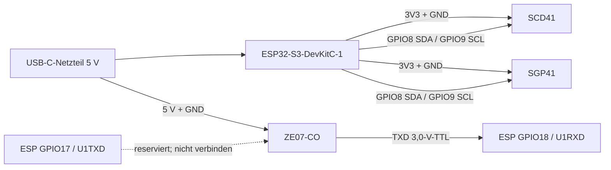

# AirQSensor

ESPHome-Luftgütesensor für ein selbst ausgebautes LKW-Wohnmobil. Zwei baugleiche Messpunkte überwachen den Wohnbereich nahe der Truma D6E und das Fahrerhaus nahe der Eberspächer-Dieselheizung. Die Messwerte und abgeleiteten Diagnosezustände werden über die native ESPHome-API in Home Assistant bereitgestellt.

> [!CAUTION]
> Dieses Projekt ist **kein zertifiziertes CO-, Brand- oder Personenschutzgerät**. Es ersetzt weder einen zugelassenen CO-Warnmelder noch Rauchmelder oder die fachgerechte Prüfung von Heizungen und Abgasführungen. Die Schwellenwerte sind einstellbare Diagnose-Startwerte, keine garantierten Sicherheitsgrenzen.

## Hardware

Pro Modul:

| Bauteil | Aufgabe | Schnittstelle |
|---|---|---|
| ESP32-S3-DevKitC-1 | Controller, WLAN und Home Assistant | USB-C / 5 V |
| Sensirion SCD41 | CO₂, Temperatur, relative Luftfeuchte | I²C, Adresse `0x62` |
| Sensirion SGP41 | VOC- und NOx-Index | I²C, Adresse `0x59` |
| Winsen ZE07-CO | elektrochemische CO-Messung | UART, 9600 8N1 |

Der SGP41 wird mit Temperatur und Luftfeuchte des SCD41 kompensiert. Seine Baseline wird von ESPHome gespeichert. Das SCD41 läuft im stromsparenden 30-Sekunden-Modus.

## Verdrahtungsplan



| ESP32-S3 | SCD41 | SGP41 | ZE07-CO |
|---|---|---|---|
| 3V3 | VDD/VIN* | VDD/VIN* | – |
| 5V vom USB-Eingang | – | – | VIN* |
| GND | GND | GND | GND |
| GPIO8 | SDA | SDA | – |
| GPIO9 | SCL | SCL | – |
| GPIO18 (RX/U1RXD) | – | – | TXD |
| GPIO17 (TX/U1TXD) | – | – | **nicht verbinden/reserviert** |

\* Vor dem Anschluss immer die konkrete Breakout-Platine prüfen. Das nackte Winsen-Modul benötigt laut Hersteller 5–12 V und gibt UART mit 3,0-V-TTL aus. Manche Händlerplatinen besitzen eigene Regler oder Pegelwandler. SCD41/SGP41-Breakouts können ebenfalls von der Sensirion-Nennspannung abweichende VIN-Angaben haben. Alle Komponenten benötigen eine gemeinsame Masse. I²C-Pull-ups dürfen nur nach 3,3 V führen.

Der ESP empfängt auf GPIO18, dem nativen `U1RXD`-Pin des ESP32-S3. Deshalb wird **ZE07 TXD → ESP GPIO18** verbunden. Der ZE07 sendet im werkseitigen aktiven Modus jede Sekunde selbstständig; seine RXD-Leitung bleibt offen. Damit wird vermieden, den laut Datenblatt für 0–3,0-V-Daten vorgesehenen ZE07-Eingang direkt mit einem 3,3-V-Ausgang des ESP zu treiben.

GPIO17 ist der native `U1TXD`-Pin und bleibt für eine mögliche spätere Q&A-Erweiterung reserviert. Vor einer solchen Erweiterung müssen die konkrete ZE07-Platine und deren zulässiger RXD-Pegel geprüft und bei Bedarf eine geeignete unidirektionale Pegelanpassung vorgesehen werden.

### Prüfung der GPIO-Auswahl

| Funktion | GPIO | Begründung |
|---|---:|---|
| I²C SDA | 8 | frei herausgeführt, kein Boot-Strapping-Pin, für die GPIO-Matrix geeignet |
| I²C SCL | 9 | frei herausgeführt, kein Boot-Strapping-Pin, für die GPIO-Matrix geeignet |
| ZE07 UART RX | 18 | nativer `U1RXD`-Pin des ESP32-S3 |
| UART TX Reserve | 17 | nativer `U1TXD`-Pin; im aktiven ZE07-Modus nicht erforderlich |

GPIO8 und GPIO9 sind auf dem ESP32-S3-DevKitC-1 frei nutzbar und liegen zusammen mit GPIO17/18 gut zugänglich am J1-Header. GPIO0, GPIO3, GPIO45 und GPIO46 werden für dieses Projekt bewusst nicht verwendet, da sie Boot-Strapping-Funktionen besitzen. GPIO19/20 bleiben ebenfalls frei, damit die native USB-Schnittstelle nicht beeinträchtigt wird.

## Softwarestruktur

```text
.
├── wohnbereich.yaml
├── fahrerhaus.yaml
├── common/air-quality.yaml
├── components/ze07_co/
├── optional/
│   ├── cold-bridge-ds18b20.yaml
│   ├── bmp390.yaml
│   ├── sps30.yaml
│   └── status-indicators.yaml
├── home-assistant/automations.yaml
├── home-assistant/templates.yaml
└── secrets.example.yaml
```

Die lokale externe Komponente liest den aktiven 9-Byte-Datenrahmen des ZE07-CO, prüft Startbyte, Gasart, Einheit, Dezimalstellen, Prüfsumme und Messbereich. Fehlerhafte Frames werden verworfen und gezählt. Nach fünf Sekunden ohne gültigen Frame wird „CO Sensor verbunden“ ausgeschaltet.

Boarddefinition, WLAN, API-Verschlüsselung, OTA-Zugang und die authentifizierte Quelle der externen Komponente stehen bewusst separat in `wohnbereich.yaml` und `fahrerhaus.yaml`. Damit lassen sich Hardwarevarianten und Sicherheitsschlüssel je Gerät unabhängig verwalten. Sensoren, Busbelegung und Bewertungslogik werden als Remote-Package direkt aus `common/air-quality.yaml` auf GitHub geladen.

Der serielle Logger läuft auf dem ESP32-S3-DevKitC-1 explizit über `UART0` (GPIO43/44). Der ZE07 verwendet unabhängig davon UART1 mit RX auf GPIO18. Alle Logstufen bis `VERY_VERBOSE` sind einkompiliert; nach jedem Start gilt `DEBUG`. Die Konfigurationsentität „Logger Level“ kann das globale Level in Home Assistant ohne Neustart ändern. `VERBOSE` und `VERY_VERBOSE` sind nur für kurze Diagnosen vorgesehen und werden bewusst nicht über einen Neustart hinweg gespeichert. Bei jeder Konfigurations- oder Funktionsänderung wird `esphome.project.version` in `common/air-quality.yaml` erhöht. Aktuelle Projektversion: `0.2.2`.

Da das Repository privat ist, enthalten beide lokalen Geräte-YAMLs die Git-Zugangsdaten als `!secret`-Verweise sowohl beim Package als auch bei `external_components`. Dadurch reichen für ESPHome in Home Assistant die gewünschte Geräte-YAML und eine passende `secrets.yaml`; die Verzeichnisse `common/` und `components/` müssen nicht manuell kopiert werden. ESPHome prüft stündlich auf Änderungen des Branches `main`.

Für `github_password` ist ein Fine-grained GitHub Personal Access Token mit ausschließlich lesendem Zugriff auf den Inhalt dieses einen Repositorys vorgesehen. Kein GitHub-Kontopasswort verwenden. ESPHome beziehungsweise Git speichert die Zugangsdaten technisch bedingt im lokalen `.esphome`-Cache im Klartext; der Home-Assistant-Host und seine Backups müssen daher entsprechend geschützt werden.

## Home-Assistant-Entitäten

- CO₂, CO, VOC Index, NOx Index, Temperatur und Luftfeuchte
- WLAN-Signal, Uptime, Gerätestatus und ESPHome-Version
- CO-, VOC- und NOx-Trends als Änderung pro Minute
- „Lüften empfohlen“, „Heizung oder Verbrennung auffällig“, „Mögliche Abgase“ und „CO Diagnosealarm“
- eigenständige „CO Warnung“, „CO2 Warnung“ und kombinierte „CO oder CO2 Warnung“ für Automationen und EMA-Schleifen
- UART-Diagnose: Verbindung, Framefehler und gemeldeter CO-Messbereich
- Taupunkt, absolute Feuchte, geschätzte Kältebrückentemperatur und Kondensationsreserve
- Datenalter je Sensor, zusammengefasster Sensorzustand und Warnung bei veralteten Messdaten
- ZE07-Betriebsstunden mit einstellbarem Serviceintervall
- freie/minimale Heap-Größe, maximale Schleifenzeit und letzter Reset-Grund
- persistente Konfigurationswerte für alle Bewertungs- und Trendgrenzen
- zur Laufzeit einstellbares globales Logger-Level
- manuell steuerbare Board-RGB-LED mit getrennt aktivierbarer Warn- und Alarmanzeige
- vollständige, natürlich formulierte „Luftqualität Bewertung“ für Sprachassistenten
- kompakte „Luftqualität Kurzbewertung“ mit Gesamtstufe und nur den negativ beitragenden Werten

Die Bewertungslogik kombiniert Absolutwerte und Ein-Minuten-Trends. Alle Grenzen erscheinen in Home Assistant als Zahlenentitäten der Kategorie „Konfiguration“. Änderungen werden auf dem ESP gespeichert und bleiben nach einem Neustart erhalten. Die Startwerte können zusätzlich über die `substitutions` am Anfang von `common/air-quality.yaml` geändert werden. Bereits gespeicherte HA-Werte haben danach Vorrang. Trends direkt nach Neustart benötigen mindestens zwei Messintervalle.

Die Binärsensoren „CO Warnung“ und „CO2 Warnung“ reagieren ausschließlich auf die Absolutwerte. CO verwendet „Grenzwert CO erhöht“ (standardmäßig 5 ppm), CO₂ verwendet „Grenzwert CO2 lüften“ (standardmäßig 1000 ppm). „CO oder CO2 Warnung“ fasst beide Zustände per ODER zusammen und eignet sich damit als einzelner Eingang für Home-Assistant-Automationen oder eine EMA-Dauerschleife. Zur Entprellung muss CO 10 Sekunden und CO₂ 30 Sekunden über dem Wert liegen; nach Unterschreitung bleibt die Warnung noch zwei Minuten aktiv.

### Startwerte der Bewertung

| Parameter | Auffällig / Lüften ab | Hoch / kritisch ab | Empfohlener Bereich |
|---|---:|---:|---:|
| CO | 5 ppm | 30 ppm Diagnosealarm | möglichst 0 ppm |
| CO₂ | 1000 ppm | 2000 ppm | unter 1000 ppm |
| VOC Index | 150 | 250 | um den adaptiven Normalwert 100 |
| NOx Index | 2 | 10 | nahe dem adaptiven Normalwert 1 |
| Temperatur | – | – | 20–24 °C |
| relative Luftfeuchte | – | – | 40–60 % |
| CO-Anstieg | 2 ppm/min | – | – |
| VOC-Anstieg | 5 Indexpunkte/min | – | – |
| NOx-Anstieg | 2 Indexpunkte/min | – | – |
| geschätzte Kondensationsreserve | unter 3 K | unter 0 K | möglichst über 3 K |
| maximale Messwertalterung | 120 s | – | darunter |

Die VOC- und NOx-Grenzen sind bewusst anpassbare Diagnose-Startwerte. Nach Sensirion entspricht VOC Index 100 der mittleren Gaszusammensetzung der vergangenen 24 Stunden; beim NOx Index wird der adaptive Normalzustand auf 1 abgebildet. Die Indizes sind daher relative Ereignissignale und keine Konzentrationen oder allgemeingültigen Gesundheitsgrenzwerte. Die Reihenfolge der jeweils niedrigen und hohen Grenzwerte muss beim Anpassen erhalten bleiben.

Die lokale Substitution `assessment_location` legt die Ortsformulierung beider Bewertungssensoren fest. Vorkonfiguriert sind `im Wohnbereich` und `im Fahrerhaus`; andere grammatisch passende Angaben wie `in der Schlafkabine` sind möglich. Fehlt die lokale Substitution in einer älteren Geräte-YAML, verwendet das gemeinsame Package den kompatiblen Standard `am Messort`.

Der Textsensor „Luftqualität Bewertung“ nennt Gesamtstufe, Messwert und Einzelbewertung aller sechs Umweltparameter sowie eine priorisierte Empfehlung. Sein Zustand ist bewusst als vollständiger deutscher Satz formuliert und kann in Home-Assistant-Skripten oder Assist-Intents direkt als Sprachausgabe verwendet werden, zum Beispiel: „Die Luftqualität im Wohnbereich ist auffällig. CO2 1350 ppm, erhöht; … Empfehlung: jetzt lüften.“

Die zusätzliche „Luftqualität Kurzbewertung“ nennt bei guter Luft nur die Gesamtbewertung. Bei Abweichungen folgen ausschließlich Werte, die die Gesamtstufe verschlechtern, zum Beispiel: „Die Luftqualität im Wohnbereich ist auffällig. Auffällig: Kohlendioxid 1350 ppm; Feuchte 68 Prozent.“ Aktive Abgas- oder Verbrennungstrends werden ebenfalls knapp genannt.

### Kondensation und Wartung

Ohne externen Oberflächenfühler schätzt das Basispaket die Temperatur einer Kältebrücke als Raumtemperatur minus einer in Home Assistant einstellbaren Differenz. Aus dieser Temperatur und dem berechneten Taupunkt entsteht die „Geschätzte Kondensationsreserve“. Werte unter 3 K lösen eine Warnung aus, Werte unter 0 K bedeuten rechnerisch Kondensation. Das ist ein Diagnosemodell: Für bekannte kalte Stellen sollte die Differenz mit realen Messungen abgeglichen oder das optionale DS18B20-Paket verwendet werden.

„Messdaten aktuell“ wird nur aktiv, wenn SCD41, SGP41 und ZE07 innerhalb des konfigurierten Zeitfensters gültige Daten geliefert haben. Der Textsensor „Sensorzustand“ nennt konkret die fehlende oder überalterte Quelle. Die ZE07-Betriebszeit wird in Sechs-Stunden-Schritten verschleißarm im Flash gesichert; der Startwert für die Serviceerinnerung beträgt drei Jahre. Die Erinnerung ersetzt weder Funktionsprüfung noch die Herstellerangaben zur Sensorlebensdauer.

Die standardmäßig deaktivierten Wartungsschaltflächen erlauben eine kontrollierte SCD41-Zwangskalibrierung, einen SCD41-Werksreset und das Zurücksetzen der ZE07-Betriebsstunden. Vor einer Zwangskalibrierung muss der SCD41 mindestens drei Minuten in einer homogenen Umgebung mit verlässlich bekannter CO₂-Konzentration laufen. Ein Werksreset löscht die Kalibrierdaten des SCD41 und darf nicht als allgemeine Fehlerbehebung ausgelöst werden.

## Optionale Hardwarepakete

Die Pakete unter `optional/` werden nicht automatisch geladen. Nur tatsächlich vorhandene Hardware darf in der Geräte-YAML ergänzt werden. Bei der aktuellen privaten GitHub-Package-Konfiguration werden die gewünschten Dateien einfach der bestehenden `files`-Liste hinzugefügt:

```yaml
packages:
  air_quality:
    url: https://github.com/trinler007/AirQSensor
    username: !secret github_username
    password: !secret github_password
    ref: main
    files:
      - common/air-quality.yaml
      # Nur bei eingebauter Hardware aktivieren:
      - optional/cold-bridge-ds18b20.yaml
      - optional/bmp390.yaml
      - optional/sps30.yaml
      - optional/status-indicators.yaml
    refresh: 1h
```

| Paket | Zusatzhardware und Anschluss | Funktion |
|---|---|---|
| `cold-bridge-ds18b20.yaml` | DS18B20 DATA an GPIO4, 4,7-kΩ-Pull-up nach 3,3 V | reale Oberflächentemperatur und gemessene Kondensationsreserve |
| `bmp390.yaml` | BMP390 an I²C GPIO8/9 und 3,3 V, Standardadresse `0x77` | Luftdruck und laufende Druckkompensation des SCD41 |
| `sps30.yaml` | SPS30 an I²C GPIO8/9 und 5 V; `SEL` auf GND | PM1/PM2,5/PM4/PM10, Partikelgröße und manuelle Lüfterreinigung |
| `status-indicators.yaml` | aktiver Buzzer über Transistor an GPIO7 | optionaler akustischer CO-/Abgasalarm und gemeinsamer Test mit der Board-RGB-LED |

Alle Zusatzmodule benötigen eine gemeinsame Masse. Beim SPS30 müssen SDA/SCL sicher auf 3,3-V-Pegel begrenzt sein; keine 5-V-I²C-Pull-ups mit dem ESP32 verbinden. Den Buzzer nicht direkt aus einem GPIO speisen, sondern passend zu dessen Stromaufnahme über Transistor und gegebenenfalls Freilaufdiode schalten.

### LEDs auf dem ESP32-S3-DevKitC-1

Die rote LED des Boards ist die direkt an der 3,3-V-Versorgung angeschlossene Betriebsanzeige. Sie besitzt keinen steuerbaren GPIO und kann deshalb nicht per ESPHome ausgeschaltet werden. Für einen dunklen Nachtbetrieb kann sie reversibel mit lichtdichtem Elektronik- oder Polyimidband abgedeckt werden. Das Entfernen der LED oder ihres Vorwiderstands ist eine Hardwareänderung und sollte nur bei entsprechender Lötpraxis erfolgen.

Die adressierbare Board-RGB-LED erscheint in Home Assistant als „Board RGB-LED“ und kann dort einschließlich Farbe und Helligkeit manuell gesteuert werden. Im Normalbetrieb und nach jedem Start bleibt sie aus; es gibt ausdrücklich keine grüne „Gut“-Anzeige. Zwei standardmäßig ausgeschaltete Konfigurationsschalter aktivieren bei Bedarf die automatische Anzeige:

- „RGB Warnanzeige automatisch“: blau bei fehlenden Sensordaten, orange bei Lüftungs-, Verbrennungs-, Kondensations- oder Servicewarnungen
- „RGB Alarmanzeige automatisch“: rot bei CO-Diagnosealarm oder möglichem Abgastrend

Warn- und Alarmhelligkeit sind getrennt in Home Assistant einstellbar. Nach Ende einer automatischen Anzeige wird die LED wieder ausgeschaltet. Solange keine Automatik aktiv ist, bleibt eine manuell gewählte Farbe erhalten.

Bei der ersten Boardrevision liegt die RGB-LED auf GPIO48, bei DevKitC-1 v1.1 auf GPIO38. Deshalb enthalten `wohnbereich.yaml` und `fahrerhaus.yaml` die Substitution `onboard_rgb_pin`. Steht auf der Platine `v1.1`, muss sie vor dem Kompilieren auf `GPIO38` geändert werden; andernfalls bleibt der voreingestellte `GPIO48` bestehen.

### Messpunktübergreifende Home-Assistant-Auswertung

`home-assistant/templates.yaml` enthält eine zusätzliche Diagnose, die Wohnbereich und Fahrerhaus vergleicht. Sind beide Messpunkte gleichzeitig auffällig, spricht das eher für eine gemeinsame Quelle oder Außenluft; ist nur ein Bereich betroffen, nennt der Textsensor diesen als wahrscheinliche lokale Quelle. Nach dem Kopieren in den Home-Assistant-Konfigurationsordner kann die Datei beispielsweise so eingebunden werden:

```yaml
template: !include home-assistant/templates.yaml
```

Die Entity-IDs in der Datei sind auf die mitgelieferten Gerätenamen ausgelegt und müssen nach der ersten Einbindung mit den tatsächlich von Home Assistant erzeugten IDs abgeglichen werden.

## Inbetriebnahme

1. `secrets.example.yaml` als `secrets.yaml` kopieren und Zugangsdaten einsetzen. `github_password` erhält ein auf dieses Repository beschränktes Fine-grained GitHub-Lesetoken. Wohnbereich und Fahrerhaus verwenden getrennte API-Schlüssel sowie getrennte OTA- und Fallback-Passwörter; WLAN- und GitHub-Zugang sind standardmäßig gemeinsam.
2. `wohnbereich.yaml` oder `fahrerhaus.yaml` in den ESPHome-Konfigurationsordner von Home Assistant übernehmen. Das gemeinsame Package und die ZE07-Komponente werden beim Validieren beziehungsweise Kompilieren von GitHub geladen.
3. Verdrahtung und Versorgungsspannungen am konkreten Breakout prüfen. Noch keinen Sensor in ein geschlossenes Gehäuse setzen.
4. Konfiguration validieren: `esphome config wohnbereich.yaml` und `esphome config fahrerhaus.yaml`.
5. Erstinstallation per USB: `esphome run wohnbereich.yaml` beziehungsweise `esphome run fahrerhaus.yaml`.
6. Beide Geräte in Home Assistant übernehmen und die Messwerte mehrere Tage vergleichen.
7. Die Beispiele aus `home-assistant/automations.yaml` und bei Bedarf `home-assistant/templates.yaml` in Home Assistant übernehmen und `notify.mobile_app_MEIN_TELEFON` sowie die Entity-IDs anpassen. Enthalten sind Meldungen für CO, mögliche Abgase, fehlende Sensordaten, anhaltendes Kondensationsrisiko und das ZE07-Serviceintervall.

SCD41 und SGP41 benötigen geeignete Einlauf- und Betriebsbedingungen. Automatische SCD41-Selbstkalibrierung ist nur sinnvoll, wenn der Sensor regelmäßig über längere Zeit Frischluftniveau sieht. Im dauerhaft bewohnten oder selten gelüfteten Fahrzeug sollte ASC geprüft und gegebenenfalls deaktiviert sowie kontrolliert zwangskalibriert werden. Der ZE07-CO benötigt laut Hersteller bis zu drei Minuten Aufwärmzeit und hat eine typische Sensorlebensdauer von 3–5 Jahren in Luft.

## Gehäuse und Montage

- PETG-Wandgehäuse mit großen seitlichen Lüftungsschlitzen
- freie, passive Luftzirkulation; keine direkte Anströmung durch Auslässe
- Abstand zu ESP32, Spannungsreglern und anderen Wärmequellen, besonders beim SCD41
- Schutz vor Kondensation, Kochspritzern, Reinigungsmitteln und direkter Sonne
- USB-C zugänglich; Sensoröffnungen nicht mit Kleber oder Lack verschließen
- nicht in Toträumen montieren und nicht so nah an der Heizung, dass nur lokale Hitze statt Raumluft gemessen wird

Feinstaub, Luftdruck, reale Kältebrückentemperatur und Buzzer sind über die beschriebenen optionalen Pakete vorbereitet. Die eingebaute RGB-LED gehört bereits zum Basispaket. Ein zusätzlicher Helligkeitssensor bleibt eine mögliche spätere Erweiterung.

## Quellen

- [ESPHome SCD4X](https://esphome.io/components/sensor/scd4x/)
- [ESPHome SGP4X](https://esphome.io/components/sensor/sgp4x/)
- [ESPHome Template Number](https://esphome.io/components/number/template/)
- [ESPHome Logger und Logger Select](https://esphome.io/components/logger/)
- [ESPHome Debug-Komponente](https://esphome.io/components/debug/)
- [ESPHome UART](https://esphome.io/components/uart/)
- [ESPHome DS18B20](https://esphome.io/components/sensor/dallas_temp/)
- [ESPHome BMP3XX](https://esphome.io/components/sensor/bmp3xx/)
- [ESPHome SPS30](https://esphome.io/components/sensor/sps30/)
- [ESPHome ESP32-RMT-LED-Strip](https://esphome.io/components/light/esp32_rmt_led_strip/)
- [Sensirion SPS30 Produktseite](https://sensirion.com/products/catalog/SPS30)
- [Sensirion SGP41 Datenblatt und Interpretation der Gasindizes](https://sensirion.com/media/documents/5FE8673C/61E96F50/Sensirion_Gas_Sensors_Datasheet_SGP41.pdf)
- [Umweltbundesamt: CO₂-Leitwerte für Innenräume](https://www.umweltbundesamt.de/richtig-lueften-in-schulen)
- [Umweltbundesamt: empfohlene relative Luftfeuchte](https://www.umweltbundesamt.de/en/node/3086)
- [Winsen ZE07-CO Produktseite](https://www.winsen-sensor.com/product/ze07-co.html)
- [Winsen ZE07-CO Handbuch](https://www.winsen-sensor.com/d/files/manual/ze07-co.pdf)

## Lizenz

MIT – siehe [LICENSE](LICENSE).
